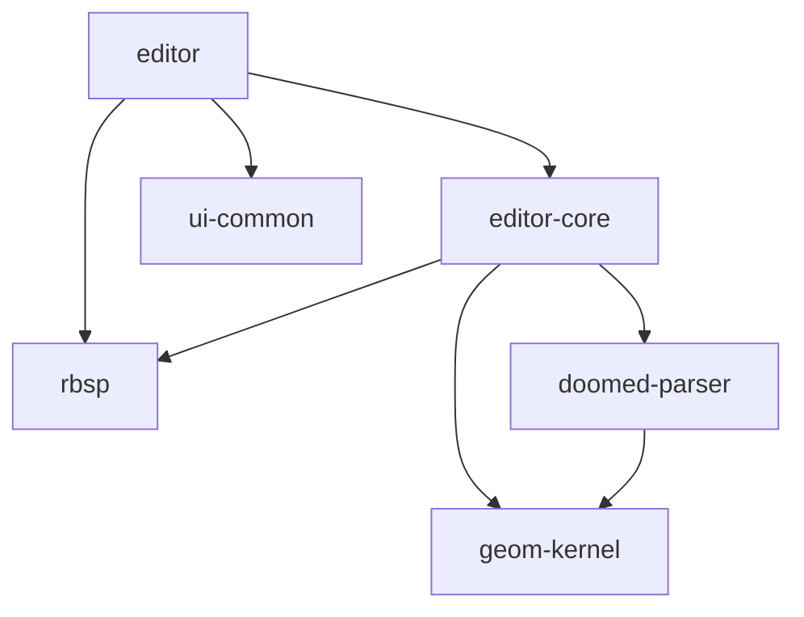

# Editor architecture

## Directory map

```text
tools/editor/src/
├── main.rs               Startup
├── app/                  Shell, menus, appearance, project I/O and jobs
├── tabs/
│   ├── wad_browser/      WAD tree, lump list and previews
│   ├── map_editor/       Canvas, toolbar, status, inspectors and commands
│   └── texture_editor/   Textures, patches and asset undo/redo
├── dialogs/              Preferences, project settings, wall/sector edits,
│                         animations, asset picker, remap, audit and BSP build
├── components/           Shared native controls and text fields
├── level_editor/         Tools, selection and editing operations
├── undo.rs               Undo/redo stack
├── render/               wgpu canvas, camera, picking and GPU caches
├── assets/               WAD assets and working texture data
└── gfx/                  Thumbnail and preview composition
```

## Dependencies

Selected crate dependencies; arrows mean “depends on”.



Rendering details: [DAMAGE.md](DAMAGE.md).
